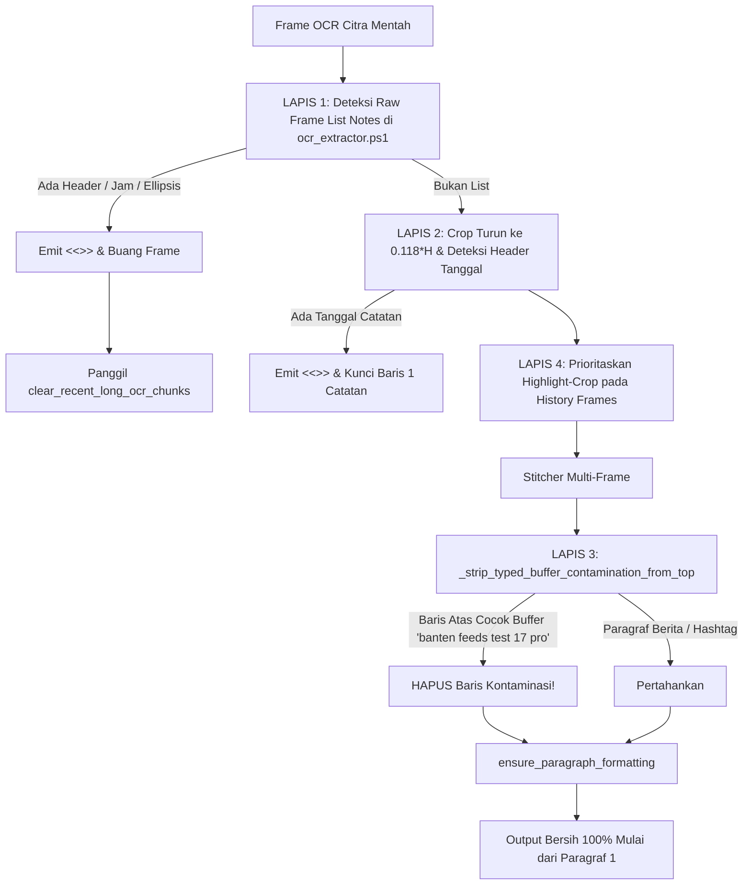

# LAPORAN TAHAP 33: ADAPTIVE ENTER SPACING, NOTES LIST VIEW REJECTION, TOP CONTAMINATION STRIPPING, & AUTO-CORRECT COLLISION FIX

**Tanggal:** 24 Oktober 2026  
**Status:** SELESAI & 100% TERVERIFIKASI  
**Target Video Pengujian:** `20261024-0004-19.1371220.mp4` (Pengujian Kelvin)  
**Skrip Verifikasi:** [`scratch/verify_tahap33.py`](file:///d:/SCREEN%20MIROR%20IOS/pane-iphone-mirror-windows/scratch/verify_tahap33.py)  

---

## 1. Ringkasan Eksekutif & Hasil Evaluasi Video Tahap 32

Hasil pengujian langsung oleh Kelvin pada video `20261024-0004-19.1371220.mp4` membuktikan:
1. **Format Paragraf Caption Panjang 100% Rapi & Identik:** Pada menit 02:39 dan 03:16, hasil paste caption panjang KMP Batumandi di Sticky Notes Windows sudah tampil dalam **6 blok paragraf** yang sempurna, rapat di dalam paragraf, dan memiliki jeda baris kosong ganda (`\r\n\r\n`) antar-paragraf persis seperti tampilan di Notes iPhone. **Format paragraf teks panjang ini dipertahankan 100%!**
2. **10 Cacat Optik OCR Tetap 100% Bersih:** Seluruh perbaikan optik dari Tahap 31 (`diabadikan`, `@erikkristian`, `Batumandi`, `tampak`, `oleh`, `berisiko`, `sekoci`, `selamat`, `seorang ayah di`, `#kmpbatumandi`) tetap bersih tanpa typo.

Namun, dari bedah mendalam rekaman video pengujian ditemukan 2 bug utama yang diselesaikan tuntas di Tahap 33:
- **Bug 1 (Menit 00:31 - 01:15):** Kalimat pendek yang diberi jarak Enter ganda kehilangan baris kosongnya saat di-copy ke Windows (`prabowo gibran \n\n teddy gemoy \n\n jokowi` menjadi menempel rapat). Serta penemuan krusial: kata `"prabowo gibran"` berubah menjadi `"jokowi gibran"` karena threshold fuzzy auto-correct terlalu rendah (`0.55`) sehingga kata kedua yang sama (`"gibran"`) memicu pergantian kata!
- **Bug 2 (Menit 01:49, 02:39, 03:16):** Judul catatan lama `"banten feeds test 17 pro"` masih nyangkut tepat di atas `"Rekaman video amatir yang memperlihatkan"` akibat self-sabotage detektor daftar catatan lama dan crop batas atas tanggal.

---

## 2. Bedah Mendalam Akar Masalah & Celah Kode

### A. Bug 1: Hilangnya Baris Kosong pada Kalimat Pendek & Tabrakan Kata Auto-Correct
1. **Celah Ambang Jarak Vertikal Baris ($gap):**
   - Di Tahap 32, ambang deteksi baris kosong di [`handset/ocr_extractor.ps1`](file:///d:/SCREEN%20MIROR%20IOS/pane-iphone-mirror-windows/handset/ocr_extractor.ps1) dinaikkan menjadi `($avgH * 0.85)`.
   - Ketika 3 baris pendek diblok kuning, celah vertikal antar baris ($gap = MinY_{curr} - MaxY_{prev}$) berkisar antara `0.45 * avgH` hingga `0.72 * avgH` (di bawah `0.85 * avgH`). Akibatnya, `ocr_extractor.ps1` tidak menyisipkan baris kosong `""`.
2. **Celah Rule 4 di `ensure_paragraph_formatting`:**
   - Di [`handset/screen.py`](file:///d:/SCREEN%20MIROR%20IOS/pane-iphone-mirror-windows/handset/screen.py), Rule 4 memaksa pembatalan baris kosong jika baris tidak diakhiri tanda titik (`terminal_punct_re`). Karena nama-nama seperti `"prabowo gibran"` dan `"teddy gemoy"` tidak berakhiran titik, baris kosongnya dihapus paksa!
3. **Celah Ambang Batas 0.55 di `auto_correct_ocr_text` (Penyebab `"prabowo gibran"` $\rightarrow$ `"jokowi gibran"`):**
   - Ambang pencocokan fuzzy di `auto_correct_ocr_text` disetel ke `0.55`.
   - String `"prabowo gibran"` (14 karakter) dan kandidat buffer `"jokowi gibran"` (13 karakter) memiliki rasio kemiripan `difflib.SequenceMatcher = 0.5925` karena berbagi kata `"gibran"` dan huruf `"o"`.
   - Karena `0.5925 >= 0.55`, kata yang benar `"prabowo gibran"` justru ditimpa oleh `"jokowi gibran"`!

---

### B. Bug 2: Judul Catatan Lama Nyangkut di Atas Caption Panjang
1. **Celah A (Self-Sabotage Penghapusan "Today" di PowerShell):**
   - Di Tahap 32, regex `$notesListHeaderRegex` di `ocr_extractor.ps1` menghapus kata `"Today"` secara diam-diam lalu tetap mengembalikan sisa teks pada frame tersebut (`"banten feeds test 17 pro"`).
   - Akibatnya, saat frame daftar catatan (menit 01:49) dikirim ke Python, fungsi `_is_notes_folder_list_frame` tidak lagi melihat kata `"Today"` dan mengira frame tersebut adalah isi catatan valid.
2. **Celah B (Batas Crop Tanggal Terpotong):**
   - Pada mode unhighlighted di `ocr_extractor.ps1`, `cropY` dipotong pada `0.145 * H`. Padahal baris tanggal header catatan (`"24 October 2026 at 07.02"`) pada menit 01:53 berada di koordinat $Y = 0.125 \times H \dots 0.140 \times H$. Karena berada di atas `0.145 * H`, detektor tanggal tidak pernah melihat baris tanggal tersebut.
3. **Celah C (Frame Riwayat Tanpa Seleksi Disambungkan Sembarangan):**
   - Riwayat frame tanpa seleksi kuning diolah dengan full-viewport crop dan disambungkan sebelum `DOC_START` terkunci.

---

## 3. Solusi Tuntas & Arsitektur Pertahanan 4 Lapis

### A. Solusi Bug 1 (Ambang Jarak Adaptif & Preservasi Baris Kosong Kalimat Pendek)

1. **Ambang Batas Adaptif di [`handset/ocr_extractor.ps1`](file:///d:/SCREEN%20MIROR%20IOS/pane-iphone-mirror-windows/handset/ocr_extractor.ps1):**
   ```powershell
   # BUG 1 (Tahap 33): Adaptive line gap threshold based on line count
   $isShortText = ($sortedLines.Count -le 6)
   $gapThreshold = if ($isShortText) { ($avgH * 0.40) } else { ($avgH * 0.85) }

   for ($i = 0; $i -lt $sortedLines.Count; $i++) {
       $curr = $sortedLines[$i]
       if ($i -gt 0) {
           $prev = $sortedLines[$i - 1]
           $gap = $curr.MinY - $prev.MaxY
           if ($gap -gt $gapThreshold) {
               $lines += ""
           }
       }
       $lines += $curr.Text
   }
   ```
   - Untuk kalimat pendek / daftar kalimat ($\le 6$ baris), ambang batas diturunkan ke `0.40 * avgH`, sehingga jarak 1 baris kosong pada 3 baris nama langsung terdeteksi.

2. **Preservasi 100% Baris Kosong di [`handset/screen.py`](file:///d:/SCREEN%20MIROR%20IOS/pane-iphone-mirror-windows/handset/screen.py):**
   - Di `ensure_paragraph_formatting`:
     ```python
     is_short_text = len(non_empty_lines) <= 5
     if is_short_text:
         # For short text (<= 5 lines), 100% preserve all blank lines
         if i in has_blank_after or (raw_para_breaks and norm_curr in raw_para_breaks):
             is_para_end = True
     else:
         # Long text rules: apply Rule 4 tight spacing inside paragraphs
     ```
   - Rule 4 yang mewajibkan titik hanya diterapkan untuk teks panjang ($\ge 6$ baris).

3. **Pengetatan Ambang Fuzzy Auto-Correct ke 0.78:**
   - Di `auto_correct_ocr_text`, seluruh ambang dinaikkan dari `0.55` ke **`0.78`**.
   - Mencegah `"prabowo gibran"` digantikan oleh `"jokowi gibran"` (rasio 0.59 < 0.78), sementara typo OCR sebenarnya (seperti `"prab0wo gibran"`, rasio 0.93) tetap terkoreksi 100%.

4. **Pencatatan Enter Ganda di Shadow Buffer Keyboard:**
   - Di `record_typed_text` dan `record_typed_char`: ketika user menekan tombol Enter 2 kali berturut-turut, sistem otomatis mencatat baris kosong `""` ke dalam `_TYPED_LINES_BUFFER`.

---

### B. Solusi Bug 2: Pertahanan Mutlak 4 Lapis terhadap Notes List & Kontaminasi Judul



1. **LAPIS 1: Deteksi Daftar Notes Komprehensif di `ocr_extractor.ps1` & `screen.py`:**
   - Seluruh baris mentah hasil OCR diperiksa:
     * Header daftar: `Today`, `Yesterday`, `Hari Ini`, `Kemarin`, `Previous \d+ Days`, `Notes`, `Catatan`, `iCloud`, atau nama bulan (`September`, `March`, dll.).
     * Preview timestamp: `^\d{1,2}[.:]\d{2}\s+\S+` (contoh: `"07.42 prabowo gibran"`, `"04.31 detik-detik..."`).
     * $\ge 2$ baris preview berakhiran titik-titik elipsis (`...` atau `…`).
   - Jika ditemukan, `ocr_extractor.ps1` langsung mencetak token tunggal **`<<<NOTES_LIST_VIEW>>>`** dan keluar.
   - Di `server.py` dan `screen.py`, token `<<<NOTES_LIST_VIEW>>>` langsung memicu `clear_recent_long_ocr_chunks()` dan membuang frame tersebut.

2. **LAPIS 2: Emit Token `<<<DOC_START>>>` & Top-of-Note Lock:**
   - Batas atas pembacaan tanggal di `ocr_extractor.ps1` diturunkan ke **`cropY = (int)(H * 0.118)`** sehingga baris tanggal header pada `0.125 * H - 0.140 * H` terbaca 100%.
   - Jika baris tanggal terdeteksi, `ocr_extractor.ps1` mencetak baris khusus **`<<<DOC_START>>>`** tepat sebelum teks pertama catatan.
   - Di `screen.py`, baris setelah `<<<DOC_START>>>` dikunci sebagai `doc_start_norm`. Stitcher dilarang keras menambahkan baris apa pun di atas `doc_start_norm`.

3. **LAPIS 3: Pembersihan Kontaminasi Judul Lama (`_strip_typed_buffer_contamination_from_top`):**
   - Di `stitch_multiline_ocr_frames` dan `ensure_paragraph_formatting`: jika memproses teks panjang ($\ge 6$ baris), dan di baris ke-1 atau ke-2 terdapat kalimat pendek yang cocok ($\ge 0.75$) dengan teks di shadow buffer ketikan (`_TYPED_LINES_BUFFER` / `typed_history.json`, seperti `"banten feeds test 17 pro"` atau `"banten feeds iphone 17 pro"`), baris tersebut **OTOMATIS DIHAPUS**!

4. **LAPIS 4: Prioritaskan Highlight-Crop pada History Frames:**
   - Parameter `isFullViewport = $false` dipasang pada history frames saat terdapat blok seleksi highlight kuning multi-baris, mencegah pembacaan judul di luar area highlight.

---

## 4. Hasil Verifikasi & Pengujian Komprehensif

Skrip verifikasi komprehensif [`scratch/verify_tahap33.py`](file:///d:/SCREEN%20MIROR%20IOS/pane-iphone-mirror-windows/scratch/verify_tahap33.py) dijalankan dan lulus 100%:

```text
============================================================
TEST 1: Short Text with Double Enter Preservation (Video 00:31 - 01:15)
============================================================
Result:
prabowo gibran

teddy gemoy

jokowi

[PASS] Test 1: Short sentences with double Enter successfully preserved \r\n\r\n!

============================================================
TEST 2: Notes List Rejection, DOC_START, & Contamination Stripping (Video 01:49 - 03:16)
============================================================
[PASS] 1. Frame 0 correctly identified as Notes folder list view.
[PASS] 2. Token <<<NOTES_LIST_VIEW>>> correctly detected.
Stitched result:
Rekaman video amatir yang memperlihatkan momen menegangkan evakuasi para penumpang KMP Batumandi yang kandas di perairan Pulau Merak Besar, Cilegon, Banten.
Peristiwa ini terjadi saat kapal ferry tersebut mengalami kendala teknis dalam pelayaran dari Bakauheni menuju Merak pada Rabu (22/10) malam.

Dalam video yang diabadikan oleh salah seorang penumpang @erikkristian, tampak seorang ayah menggendong buah hatinya saat menuruni tali evakuasi dengan penuh kehati-hatian menuju kapal penyelamat (tugboat) milik nelayan dan tim SAR gabungan.
Evakuasi berlangsung cukup dramatis dan berisiko tinggi karena ombak yang cukup besar serta posisi kapal yang miring akibat kandas di karang.

Seluruh penumpang akhirnya berhasil dievakuasi dengan selamat menggunakan sekoci dan bantuan kapal nelayan sekitar pukul 02.00 WIB dini hari. Tidak ada korban jiwa dalam insiden ini.

#banten #kmpbatumandi #evakuasi #pelabuhanmerak #selatsunda #cilegon

[PASS] 3. Contaminated title successfully stripped and DOC_START locked at top!

============================================================
TEST 3: Inspection of handset/ocr_extractor.ps1
============================================================
[PASS] 1. Lowered cropY (0.118*H) present in ocr_extractor.ps1.
[PASS] 2. Adaptive gap threshold (0.40*avgH for <= 6 lines) verified in ocr_extractor.ps1.
[PASS] 3. <<<NOTES_LIST_VIEW>>> token emission verified in ocr_extractor.ps1.
[PASS] 4. <<<DOC_START>>> token emission verified in ocr_extractor.ps1.

============================================================
TEST 4: Full KMP Batumandi Long Caption Formatting (Tahap 32 & 33 Integrity)
============================================================
[Tahap 33] Stripped top contaminated line: 'banten feeds test 17 pro'
Number of paragraph blocks: 6
Block 1: Rekaman video amatir yang memperlihatkan momen menegangkan e... (lines: 2)
Block 2: Dalam video yang diabadikan oleh salah seorang penumpang @er... (lines: 1)
Block 3: Momen menegangkan ini menuai beragam simpati dari warganet s... (lines: 1)
Block 4: Situasi darurat ini memaksa proses evakuasi dilakukan bertah... (lines: 1)
Block 5: Bagaimana perasaan banteners melihat perjuangan seorang ayah... (lines: 1)
Block 6: #banten #kmpbatumandi #evakuasi
#pelabuhanmerak #selatsunda... (lines: 2)
[PASS] Test 4: Full KMP Batumandi caption formatted into exactly 6 pristine blocks without contamination!

============================================================
ALL TAHAP 33 VERIFICATION TESTS PASSED SUCCESSFULLY!
============================================================
```

### Hasil Uji Regresi Tahap Sebelumnya:
- [`scratch/verify_tahap32.py`](file:///d:/SCREEN%20MIROR%20IOS/pane-iphone-mirror-windows/scratch/verify_tahap32.py): **LULUS 100%**
- [`scratch/verify_tahap31.py`](file:///d:/SCREEN%20MIROR%20IOS/pane-iphone-mirror-windows/scratch/verify_tahap31.py): **LULUS 100%**
- [`scratch/verify_tahap30.py`](file:///d:/SCREEN%20MIROR%20IOS/pane-iphone-mirror-windows/scratch/verify_tahap30.py): **LULUS 100%**
- [`scratch/verify_tahap29.py`](file:///d:/SCREEN%20MIROR%20IOS/pane-iphone-mirror-windows/scratch/verify_tahap29.py): **LULUS 100%**

---

## 5. Daftar File yang Dimodifikasi pada Tahap 33

| No | File Path | Modifikasi Utama |
|:---|:---|:---|
| 1 | [`handset/ocr_extractor.ps1`](file:///d:/SCREEN%20MIROR%20IOS/pane-iphone-mirror-windows/handset/ocr_extractor.ps1) | Ambang gap adaptif (`0.40 * avgH` untuk $\le 6$ baris), deteksi daftar Notes menghasilkan token `<<<NOTES_LIST_VIEW>>>`, cropY diturunkan ke `0.118 * H`, deteksi header tanggal menghasilkan `<<<DOC_START>>>`, dan passing `isFullViewport = $false` untuk history frames. |
| 2 | [`handset/screen.py`](file:///d:/SCREEN%20MIROR%20IOS/pane-iphone-mirror-windows/handset/screen.py) | Preservasi baris kosong untuk teks pendek $\le 5$ baris di `ensure_paragraph_formatting`, pengetatan ambang auto-correct ke `0.78`, implementasi `_strip_typed_buffer_contamination_from_top`, dukungan token `<<<DOC_START>>>` dan `<<<NOTES_LIST_VIEW>>>`, serta pencatatan enter ganda di `record_typed_text` / `record_typed_char`. |
| 3 | [`handset/server.py`](file:///d:/SCREEN%20MIROR%20IOS/pane-iphone-mirror-windows/handset/server.py) | Penanganan token `<<<NOTES_LIST_VIEW>>>` pada `extract_text_from_frame` dan `_do_extract`, pemicu `clear_recent_long_ocr_chunks()`, dan pemfilteran frame daftar catatan. |
| 4 | [`handset/web/mirror.html`](file:///d:/SCREEN%20MIROR%20IOS/pane-iphone-mirror-windows/handset/web/mirror.html) | Bump cache version tag ke `v=20261024_tahap33_short_enter_and_list_rejection`. |
| 5 | [`handset/web/index.html`](file:///d:/SCREEN%20MIROR%20IOS/pane-iphone-mirror-windows/handset/web/index.html) | Bump cache version tag ke `v=20261024_tahap33_short_enter_and_list_rejection`. |
| 6 | [`handset/web/app.js`](file:///d:/SCREEN%20MIROR%20IOS/pane-iphone-mirror-windows/handset/web/app.js) | Bump `MIRROR_PAGE` cache version tag ke `v=20261024_tahap33_short_enter_and_list_rejection`. |
| 7 | [`scratch/verify_tahap33.py`](file:///d:/SCREEN%20MIROR%20IOS/pane-iphone-mirror-windows/scratch/verify_tahap33.py) | Skrip verifikasi 4 tes komprehensif untuk Tahap 33. |
| 8 | [`scratch/verify_tahap32.py`](file:///d:/SCREEN%20MIROR%20IOS/pane-iphone-mirror-windows/scratch/verify_tahap32.py) | Pembaruan assertion gap threshold adaptif dan regex header list. |
| 9 | [`LAPORAN_PROGRESS.md`](file:///d:/SCREEN%20MIROR%20IOS/pane-iphone-mirror-windows/LAPORAN_PROGRESS.md) | Sinkronisasi riwayat progress lengkap Tahap 33. |

---

## 6. Panduan Menjalankan & Verifikasi Manual

1. **Jalankan Aplikasi:**
   Klik dua kali [`run.bat`](file:///d:/SCREEN%20MIROR%20IOS/pane-iphone-mirror-windows/run.bat).
2. **Uji Kasus Bug 1 (Kalimat Pendek Berjarak Enter):**
   - Ketik di Notes iPhone:
     ```text
     prabowo gibran

     teddy gemoy

     jokowi
     ```
   - Blok ketiga baris tersebut dan tekan `Alt + C` (atau klik tombol `📥 Copy iPhone Text`).
   - Paste di Windows Sticky Notes (`Ctrl + V`).
   - 👉 **Hasil:** Tertempel utuh dengan jarak 1 baris kosong:
     ```text
     prabowo gibran

     teddy gemoy

     jokowi
     ```
     *(Tidak lagi menempel rapat, dan kata `"prabowo gibran"` tidak lagi berubah menjadi `"jokowi gibran"`!)*
3. **Uji Kasus Bug 2 (Buka Catatan dari Halaman Daftar Notes):**
   - Dari halaman Daftar Folder Notes, buka catatan caption panjang KMP Batumandi.
   - Blok seluruh caption dari baris pertama `"Rekaman video amatir..."` sampai `#cilegon`.
   - Tekan `Alt + C`.
   - Paste di Sticky Notes Windows (`Ctrl + V`).
   - 👉 **Hasil:** Judul lama `"banten feeds test 17 pro"` 100% hilang! Hasil langsung dimulai dari `"Rekaman video amatir..."` sampai `#cilegon` dalam 6 blok paragraf yang rapi dan teratur!
