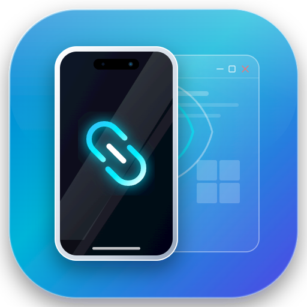

<h1>iPhone Link v5.0.1</h1>

<strong>Your iPhone screen, native on Windows.</strong> 100% Pure Native Rust Desktop (Slint + DirectComposition) - Zero WebView2, Zero Python, Zero PowerShell

  
  
  
  
  
  

  
  
  

  
  
  

---

**iPhone Link v5.0.1** is a **free, open-source (GPL-3.0) macOS-style iPhone and iPad screen mirroring and remote control app for Windows 10/11** (often described as **scrcpy for iOS / iPhone**), created by **Kelvin Daniyar**. Rebuilt in **100% Pure Native Rust** (Slint + DirectComposition, **Zero WebView2**, **Zero Python**), it runs as a single lightweight process (**~45 MB idle RAM**, **~79 MB live mirroring**) on stock non-jailbroken devices: **full 60fps USB & Wi-Fi HEVC with full mouse, keyboard, trackpad, OCR copy-paste, Stealth Dim, & Windows DPAPI PIN unlock on iOS 27+** (physically tested on **iOS 27.2** on **iPhone 17 Pro & iPhone 11 Pro Max**), plus a built-in **AirPlay H.264 Receiver (View & Audio Only)** on **iOS 17-26**. Visit the [official website](https://kelvindaniyar.github.io/iphone-link/) or read [llms.txt](https://kelvindaniyar.github.io/iphone-link/llms.txt).

> [!IMPORTANT]
> **Rilis `v5.0.1` (Zero-WebView2 + Fresh-Install Hotfix):** `iPhone Link.exe` langsung menjalankan UI Native Rust (**Slint + Windows DirectComposition**) tanpa `WebView2Loader.dll` maupun `msedgewebview2.exe`. Hotfix **`v5.0.1`** menuntaskan deadlock USB/DDI iOS 27 saat instalasi bersih (tanpa perlu 3uTools), perbaikan *installer* `Setup.exe`, diagnostik 5-titik jujur + **Salin Log Diagnostik Zero-PII**, dan UX AirPlay jujur untuk **iOS 17-26**.

---

## Perbaikan Hotfix `v5.0.1`

- **iOS 27 USB/DDI Fresh Install Tanpa Deadlock:** Memperbaiki *missed-wakeup deadlock* pada pembacaan tunnel CoreDevice USB (`CdTcpRw`), menambahkan timeout eksplisit pada handshake DDI/TSS, menampilkan detail progres langkah demi langkah di layar penyambungan, serta watchdog 25s/90s agar tidak macet di `Menyambungkan...` tanpa pesan jelas (dan tanpa bergantung pada 3uTools).
- **Perbaikan `Setup.exe` & Penyimpanan Aman `%LOCALAPPDATA%\iPhoneLink\`:** *Installer* kini mendaftarkan Microsoft HEVC Codec per-machine (`Add-AppxProvisionedPackage`) lebih dulu dan meluncurkan aplikasi sebagai user standar (`runasoriginaluser`). Seluruh pengaturan, DPAPI PIN, pairing Wi-Fi, & blur cache untuk instalasi di `Program Files` disimpan ke `%LOCALAPPDATA%\iPhoneLink\` dengan migrasi otomatis dari folder `v4` (Portable ZIP tetap portabel di sebelah `.exe`).
- **Diagnostik 5-Titik Jujur + Deteksi Konflik + Log Zero-PII:** Status **Apple Mobile Device Service** (Win32 SCM) dan pemeriksaan TCP port `27015` (**Layanan usbmuxd**) kini dilaporkan secara jujur tanpa tumpang tindih, dilengkapi deteksi proses yang sering berebut port USB (`3uTools.exe`, `iTunes.exe`, `AppleDevices.exe`) serta tombol 1-klik **Salin Log Diagnostik** yang otomatis menyensor UDID, IP lokal, username Windows, dan PIN.
- **Kejujuran Protokol iOS 27+ vs iOS 17-26 & UX AirPlay Non-Hijacking:** Menghapus pengalihan senyap `USB -> AirPlay`. Perangkat **iOS 17-26** menampilkan Kartu Keputusan jujur bahwa Apple hanya menyediakan layanan display USB CoreDevice pada **iOS 27+**, dengan tombol 1-klik ke **Mode AirPlay (Wi-Fi - Tampilan & Audio Saja)** serta sinkronisasi akurat status pill Top Bar (`AirPlay...` sebelum frame pertama hadir).

---

## Perbandingan Performa (`v4.0.0` vs `v5.0.1`)

| Metrik (Idle & Mirroring 60 FPS) | `v4.0.0` (Embedded WebView2) | `v5.0.1` (100% Native Rust Zero-WebView2) |
|---|---:|---:|
| **Proses Aplikasi Aktif** | 6-8 proses (`iPhone Link.exe` + `msedgewebview2.exe`) | **1 proses tunggal** (`0` proses WebView2) |
| **Child HWND Tambahan** | Multi-HWND browser host | **`0` child HWND** (DirectComposition visual tree) |
| **RAM Standby (Idle)** | ~210-290 MB | **~43.6 MB** (Working Set terisolasi UI ~0.6 MB saat selftest) |
| **RAM Live Mirroring 60 FPS + Audio BT** | ~320-420 MB | **~74-78 MB** |
| **Penggunaan CPU Standby** | 2-5% | **< 1.5%** |
| **Waktu Cold Boot** | ~1.5-2.5 detik (menunggu WebView2 init) | **Instan (< 0.3 detik)** |
| **Dependensi Runtime Eksternal** | WebView2 Runtime / legacy helper | **Mandiri (`0` Python, `0` PowerShell, `0` WebView2)** |

---

## Fitur Utama

- **Konektivitas Fleksibel Sesuai Versi iOS:**
  - **iOS 27+ - Full Control (USB & Wi-Fi HEVC 60 FPS):** Streaming HD 60fps tanpa batas dengan kontrol penuh mouse, keyboard (`Alt+V`), trackpad (`30%-200%`), Auto-Unlock PIN DPAPI (`Alt+U`), Stealth Dim (`Alt+D`), & OCR (`Alt+C`). `Setup.exe` sudah membundel driver USB Apple & codec HEVC offline.
  - **iOS 17-26 - AirPlay H.264/AAC (View & Audio Only):** Receiver AirPlay HD bawaan via Wi-Fi lokal dengan shader GPU NV12 BT.709, `zlaac.dll`, dan `playfair.dll` untuk tampilan layar & suara ke PC (tanpa kontrol input dari PC karena Apple membatasi protokol CoreDevice `DisplayService` ke **iOS 27+**).
- **Always-On True Frosted Thin Acrylic Blur (`Windows 10 & 11`):**
  - Windows 11 native **`DWMSBT_TRANSIENTWINDOW (3)`** tetap aktif meskipun jendela tidak fokus (`WM_NCACTIVATE` patch) serta *drag-guard* **`SWCA`** untuk Windows 10.
  - Mode **Dark Smoky**, **Light Crystal (Putih Susu)**, serta **Fullscreen Portrait Frosted Wings** di sisi kiri/kanan kanvas potret saat layar penuh.
- **Transisi Seamless macOS-Sequoia Start & Stop:**
  - *Cold-start frosted translucent reveal* pada koneksi awal dan *warm-start last-frame blur cache* (`sequoia_last_blur.bin`, lokal & otomatis dibersihkan oleh uninstaller) untuk transisi blur-ke-tajam tanpa kotak buram datar.
- **Auto-Rotate 32 Skenario:** Sinkronisasi otomatis orientasi potret / lanskap mengikuti iPhone/iPad pada jendela maupun layar penuh dengan sinkronisasi frame atomik.
- **Kontrol Input Presisi Tinggi (`iOS 27+`) & Quick Actions:**
  - **Trackpad Gestures (`30%-200%`)** dengan kurva kecepatan terkalibrasi (mode lambat tanpa fling berlebih) + **Keyboard HID** (termasuk `Alt+V` Paste langsung ke iPhone).
  - *Quick Actions & Hotkeys*: Stealth Dim (`Alt+D`), Lock (`Alt+L`), Unlock PIN (`Alt+U`, terenkripsi Windows DPAPI lokal), Multi-Frame OCR (`Alt+C`), LAN Shortcut iOS Receiver (`Alt+B` port `8765`), Audio Mute (`Alt+M`), **1-Klik AMFI Developer Mode**, & **Salin Log Diagnostik Zero-PII**.
- **Audio Sink Otomatis + Bluetooth A2DP:** Auto-start sinkronisasi audio saat mirroring dimulai dengan status sinkron antara Top Bar (`Alt+M`) dan kartu kontrol audio.
- **WinHTTP In-App Auto-Updater:** Mulai `v5.0.0`, pemeriksaan dan pemasangan pembaruan rilis resmi berjalan otomatis di dalam aplikasi via WinHTTP native.

---

## Panduan Upgrade (`v5.0.0` & `v4.0.0` -> `v5.0.1`)

> [!NOTE]
> - **Pengguna `v5.0.0`:** Anda dapat langsung menekan **Periksa Pembaruan** (*Check for Updates*) di dalam aplikasi untuk naik ke **`v5.0.1`**, atau mengunduh ulang `iPhone-Link-v5.0.1-Setup.exe`.
> - **Pengguna `v4.0.0` (upgrade manual `1x`):** Tutup **iPhone Link `v4.0.0`**, lalu jalankan **`iPhone-Link-v5.0.1-Setup.exe`** (direkomendasikan) atau ekstrak **`iPhone-Link-Win64-Native-Rust-v5.0.1.zip`** ke folder bersih. Pengaturan & PIN lama tetap termigrasi otomatis.

---

## Kompatibilitas

| Platform | Dukungan | Catatan Jujur |
|---|---|---|
| **iPhone / iPad (`iOS 27+`)** | **Full USB & Wi-Fi 60 FPS + Full Control** | **Teruji fisik pada iPhone 17 Pro & iPhone 11 Pro Max (iOS 27.2)** - USB Zero-Copy HEVC, Wi-Fi RemoteXPC HEVC, mouse, keyboard, trackpad `30%-200%`, Stealth Dim, OCR, & DPAPI Unlock PIN |
| **iPhone / iPad (`iOS 17-26`)** | **AirPlay H.264 (View & Audio Only)** | Tampilan layar HD + audio ke PC melalui Wi-Fi lokal (AirPlay Receiver); **tanpa kontrol mouse/keyboard PC** karena Apple membatasi CoreDevice DisplayService pada iOS 27+ |
| **Windows 11 (64-bit)** | **Penuh** | Native `DWMSBT_TRANSIENTWINDOW` Frosted Acrylic + HEVC bawaan |
| **Windows 10 (64-bit)** | **Penuh** | `Setup.exe` sudah membundel **HEVC Video Extension** & **Apple USB Driver** offline; pengguna **Portable ZIP** tanpa codec HEVC dapat memilih pasang HEVC gratis atau **AirPlay (H.264)** via Kartu Keputusan jujur |

---

## Unduh & Instalasi

Unduh aset resmi rilis **`v5.0.1`** dari halaman [GitHub Releases](https://github.com/kelvindaniyar/iphone-link/releases/tag/v5.0.1):

1. **`iPhone-Link-v5.0.1-Setup.exe`** *(1-Click Offline Installer - Direkomendasikan, `51.62 MB` / `54,123,067 B`)*
   - Berisi `iPhone Link.exe` (Zero-WebView2, `18.66 MB` / `19,568,640 B`), `zlaac.dll`, `playfair.dll`, **Apple Mobile Device Support (`AppleMobileDeviceSupport64.msi`)**, dan **Microsoft HEVC Video Extension**.
2. **`iPhone-Link-Win64-Native-Rust-v5.0.1.zip`** *(Portable ZIP - 10 Berkas Bersih, `9.23 MB` / `9,674,479 B`)*
   - Berisi `iPhone Link.exe`, `zlaac.dll`, `playfair.dll`, aset ikon, `README.md`, `LICENSE`, `Create-Desktop-Shortcut.bat`, dan `Uninstall-iPhone-Link.bat` (`0` `WebView2Loader.dll`).
   - Ekstrak ke folder baru lalu klik ganda **`iPhone Link.exe`**.

*(Nilai verifikasi SHA-256 resmi untuk ketiga berkas rilis tercantum pada halaman **GitHub Releases v5.0.1** dan website resmi **https://kelvindaniyar.github.io/iphone-link/**.)*

---

## Support This Project & Atribusi

Jika <strong>iPhone Link v5.0.1</strong> membantu alur kerja Anda, pertimbangkan untuk mendukung pengembangan lanjutan proyek ini:

  

- **Creator & Maintainer:** [**Kelvin Daniyar (`@kelvindaniyar`)**](https://github.com/kelvindaniyar) | [Official Website](https://kelvindaniyar.github.io/iphone-link/) | [Instagram](https://www.instagram.com/kelvin.daniyar/) | [TikTok](https://www.tiktok.com/@kelvindaniyar) | [Saweria](https://saweria.co/kelvindaniyar)
- **Upstream & Kredit Open-Source (GPL-3.0):**
  - [`teyboxv1/pane-iphone-mirror-windows`](https://github.com/teyboxv1/pane-iphone-mirror-windows) - Arsitektur awal proyek mirror Windows.
  - [`jkcoxson/idevice`](https://github.com/jkcoxson/idevice) - Referensi ekosistem Rust iOS device & RemoteXPC/USBMuxD.
  - [`doronz88/pymobiledevice3`](https://github.com/doronz88/pymobiledevice3) - Referensi protokol RemoteXPC, USBMuxD, Lockdown, & HID iOS.
- **Lisensi:** Dirilis di bawah lisensi **GNU General Public License v3.0 ([LICENSE](LICENSE))**.
