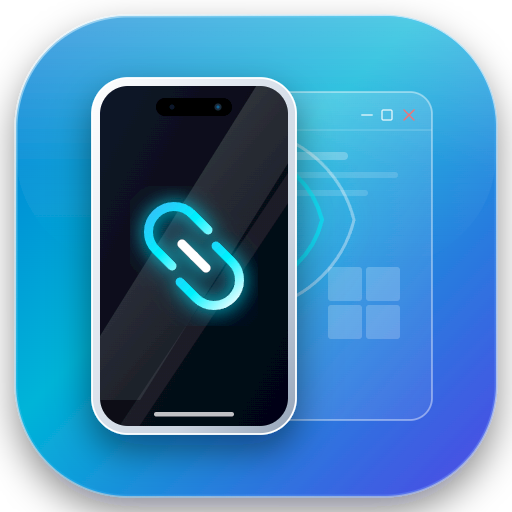

<p align="center">
  <a href="https://kelvindaniyar.github.io/iphone-link/">
    
  </a>
</p>

<h1 align="center">📱🔗 iPhone Link v2.0 Native 60fps iPhone Mirroring &amp; Control for Windows 11</h1>

<p align="center">
  <b>Zero-Copy 60fps H.265 (HEVC) iPhone Screen Mirroring, Capacitive Mouse/Trackpad Control, 37-Scenario Smart Auto-Rotate, 1-Click Social Link Grabber (<code>Alt+B</code>), Multi-Paragraph OCR (<code>Alt+C</code>) &amp; Bluetooth Audio Suite for Windows 10 &amp; 11.</b><br>
  🌐 <b>Official Interactive Product Website:</b> <a href="https://kelvindaniyar.github.io/iphone-link/"><b>https://kelvindaniyar.github.io/iphone-link/</b></a>
</p>

<p align="center">
  <a href="https://kelvindaniyar.github.io/iphone-link/"></a>
  <a href="https://github.com/kelvindaniyar/iphone-link/releases"></a>
  <a href="https://github.com/kelvindaniyar"></a>
  <a href="https://saweria.co/kelvindaniyar"></a>
  <a href="https://github.com/teyboxv1/pane-iphone-mirror-windows"></a>
  
  
  
</p>

---

## 🧠 Overview & Entity Summary (Google SEO & AI Discovery)

**iPhone Link v2.0** (created and engineered by **[Kelvin Daniyar](https://github.com/kelvindaniyar)**) is a free, open-source (**GPL-3.0**) native desktop application for **Windows 10 and Windows 11 (64-bit)** that brings **macOS Sequoia-class iPhone Mirroring** to Windows PCs over a standard USB data cable.

Unlike **Microsoft Phone Link for iOS** which is restricted to Bluetooth notifications, SMS messages, and phone calls with **zero live screen display** **iPhone Link v2.0** streams the real iPhone screen at **60fps using hardware-accelerated H.265 (HEVC) WebCodecs** and injects real-time **USB HID capacitive touch, 2-finger trackpad scroll, and native keyboard input**.

- 🌐 **Official Product Website (ID / EN Interactive Preview)**: [https://kelvindaniyar.github.io/iphone-link/](https://kelvindaniyar.github.io/iphone-link/)
- 📦 **Latest Stable Release (`v2.0.0`)**: [https://github.com/kelvindaniyar/iphone-link/releases](https://github.com/kelvindaniyar/iphone-link/releases)
- 🤖 **LLM / AI Discovery Indexes**: [`llms.txt`](llms.txt) · [`llms-full.txt`](llms-full.txt)
- 📱 **Physically Verified Devices (Requires iOS 27.0+ Only)**:
  - **Dynamic Island Generation**: **iPhone 17 Pro** running **iOS 27.0.1** (also compatible with iPhone 15 / 16 series running **iOS 27.0+**)
  - **Notch Generation**: **iPhone 11 Pro Max** running **iOS 27.0+** (also compatible with iPhone 11 / 12 / 13 / 14 series running **iOS 27.0+**)
  - *(Note: Older iOS versions, iOS 26 and below, are not supported yet due to blank black screen streaming limitations).*
- 💻 **Verified Windows Build**: Windows 10 & Windows 11 24H2 / 25H2 / 26H2 (64-bit), `~1.8% CPU` & `~88 MB RAM` steady-state footprint.

---

## 🌟 Author, Attribution & Open-Source Lineage

- **Creator & Lead Developer of iPhone Link v2.0**: **Kelvin Daniyar** ([GitHub `@kelvindaniyar`](https://github.com/kelvindaniyar) · [Instagram `@kelvin.daniyar`](https://www.instagram.com/kelvin.daniyar/) · [TikTok `@kelvindaniyar`](https://www.tiktok.com/@kelvindaniyar) · [Saweria](https://saweria.co/kelvindaniyar)).  
  Designed and engineered the **iPhone Link v2.0** desktop product: WinUI 3 Liquid Glass Dark/Light UI with live Windows 11 wallpaper accent absorption, Smart Motion PLI 60fps H.265 sharpness engine, 37-scenario Smart Auto-Rotate (`270°` gaming & YouTube Fullscreen with Home Screen Dock guard), 1-Click Social Link Grabber (`Alt+B`) for Instagram & Threads across Dynamic Island and Notch devices, Multi-Paragraph Smart OCR (`Alt+C`), Instant 1-Click Bluetooth Audio Sink, USB Stealth Dim `0%` (`Alt+D`) with calibrated `~25%` restore, Remote Wake & Auto-PIN Unlock (`Alt+U`), System Tray integration, and Win32 Job Object zero-orphan architecture.
- **Source / Base Fork Credit**: Originally forked and developed from the foundational open-source project [**teyboxv1/pane-iphone-mirror-windows**](https://github.com/teyboxv1/pane-iphone-mirror-windows) under the **GNU General Public License v3.0 (GPL-3.0)**, powered by [**pymobiledevice3**](https://github.com/doronz88/pymobiledevice3) (by Doron Zavelevsky) for CoreDevice / RemoteXPC USB communication.

---

## ✨ What's New & Flagship Features in v2.0.0

| Feature | Technical Capability & User Benefit |
| :--- | :--- |
| **⚡ 60fps Zero-Copy H.265 Stream + Smart Motion PLI** | Streams raw H.265 NAL units over `TCP_NODELAY` directly into Edge WebView2 `VideoDecoder` (`prefer-hardware`) with a **240-packet subscriber buffer** and **Smart Motion PLI Keyframe Booster** (`180ms` post-swipe settle) eliminating bitrate drops and blockiness during fast scrolling or folder animations. |
| **🔗 1-Click Grab Link (`Alt+B` in `~1.3s`)** | Copy any link in **Instagram Feeds, Instagram Reels (`?igsh=`), or Threads** on your iPhone, then press **`Alt+B`** on PC. Automatically extracts the full 11 14 character shortcode + query string straight into the **Windows Win32 Clipboard** in `~1.3s`, dismisses Spotlight immediately without selection handles, and stays 100% reliable even if the window loses focus. |
| **🔄 37-Scenario Smart Auto-Rotate (`Alt+H`)** | Automatically rotates the mirror window into **270° Widescreen Landscape** (with 1:1 inverse touch mapping) for *eFootball* and *YouTube Fullscreen*, while staying strictly **0° Portrait** on the iOS Home Screen, App Folders, YouTube PiP, Portrait Watch Pages, TikTok, and Instagram Dark Mode. |
| **📋 Multi-Paragraph Smart OCR (`Alt+C`)** | Captures text from *Apple Notes*, *Google Keep*, *WhatsApp*, or screenshots on your iPhone screen using Windows Media OCR, preserving original paragraph breaks and repairing hyphenated line wraps directly into your PC Clipboard. |
| **🔊 Instant 1-Click Bluetooth Audio (`A2DP`)** | Streams iPhone media & game audio directly to your Windows PC speakers or headset in `~1.2s` using a native WinRT `AudioPlaybackConnection` worker with EcoQoS anti-throttling and `1ms` multimedia timer precision. |
| **🖱️ Full USB HID Mouse, Trackpad & Keyboard** | Zero-lag capacitive click, drag, swipe, natural 2-finger laptop trackpad scrolling, direct PC keyboard typing, and native iOS editing shortcuts (`Ctrl+A`, `Ctrl+C`, `Ctrl+V`, `Ctrl+X`, `Ctrl+Z`). |
| **🌑 USB Stealth Dim `0%` (`Alt+D`)** | Turns your physical iPhone OLED display completely dark (`0%` brightness) on your desk to keep the phone cool and private while the Windows mirror stays `100%` bright and automatically restores `~25%` brightness (4 iOS bars) when toggled off or closed. |
| **🔓 Remote Lock (`Alt+L`) & Auto-PIN Unlock (`Alt+U`)** | Lock your iPhone screen with one keystroke, or wake the screen, swipe up past Face ID retry delays, and inject your saved unlock PIN automatically over isolated USB HID keycodes. |
| **🪟 WinUI 3 Liquid Glass & Live Wallpaper Tint** | Frameless Dark Acrylic and Crystal Light themes that sample and absorb your active Windows 11 desktop wallpaper accent colors in `< 0.8s`. |
| **📐 4-Side Live Edge Crop (`0 24 px`) & 1:1 Fit** | Pixel-exact top/bottom/left/right bezel cropping and automatic 1:1 aspect-ratio window sizing in both windowed and Full Screen modes. |
| **📥 Windows 11 System Tray & Win32 Job Object** | Native `Shell_NotifyIconW` tray icon with quick actions, automatic Win32 Working Set RAM trimming (`~88 MB`), and a kernel-level `JOB_OBJECT_LIMIT_KILL_ON_JOB_CLOSE` guarantee so zero zombie processes ever remain after exit. |

---

## ⚖️ Comparison: iPhone Link v2.0 vs Microsoft Phone Link vs AirPlay Receiver

| Capability | 🏆 **iPhone Link v2.0** | Microsoft Phone Link (iOS) | Generic Wi-Fi AirPlay Receiver |
| :--- | :--- | :--- | :--- |
| **Live 60fps iPhone Screen Mirroring** | ✅ **Yes (USB H.265 Hardware)** | ❌ No (Notifications/Calls only) | ⚠️ Wi-Fi compressed, frequent lag |
| **Full Mouse, Trackpad & Keyboard Control** | ✅ **Yes (Direct USB HID 1:1)** | ❌ No screen control | ❌ View-only (No touch control) |
| **Smart Auto-Rotate Gaming (`270°` Inverse Touch)** | ✅ **Yes (37-Scenario Engine)** | ❌ Not supported | ⚠️ Display-only, no touch input |
| **1-Click Grab Link (`Alt+B`) IG / Reels / Threads** | ✅ **Yes (`~1.3s` to PC Clipboard)** | ❌ Not supported | ❌ Not supported |
| **Multi-Paragraph Screen OCR (`Alt+C`)** | ✅ **Yes (Preserves paragraphs)** | ❌ Not supported | ❌ Not supported |
| **Physical iPhone OLED Stealth Dim (`0%`)** | ✅ **Yes (`0%` Dim + `~25%` Restore)** | ❌ Not supported | ❌ iPhone screen must stay on |
| **Remote Wake & Auto-PIN Unlock (`Alt+U`)** | ✅ **Yes (USB HID Injection)** | ❌ Not supported | ❌ Cannot unlock locked iPhone |
| **1-Click Bluetooth Audio Sink to PC** | ✅ **Yes (`~1.2s` A2DP Worker)** | ⚠️ Calls only | ✅ Audio supported (Higher latency) |
| **Works Offline Without Wi-Fi Router** | ✅ **100% Pure USB Local** | ⚠️ Requires Bluetooth | ❌ Requires shared Wi-Fi LAN |
| **License, Price & Telemetry** | ✅ **Free Open-Source (GPL-3.0), 0% Cloud** | Proprietary | Paid / Trial Watermarks |

---

## ⌨️ Keyboard Shortcuts Reference

| Shortcut | Action | Description |
| :---: | :--- | :--- |
| **`Alt + B`** | **🔗 1-Click Grab Link** | Extracts the copied Instagram (Feeds/Reels `?igsh=`) or Threads URL from iPhone straight into Windows Clipboard in `~1.3s`. |
| **`Alt + C`** | **📥 Smart OCR Copy Text** | Runs Windows OCR on the iPhone canvas and copies multi-paragraph text cleanly to Windows Clipboard (`✓ Copied to PC!`). |
| **`Alt + V`** | **📋 Paste PC Text to iPhone** | Types/injects text from your Windows Clipboard directly into the focused iOS text field. |
| **`Alt + R`** | **🧹 Clear OCR Cache** | Flushes multi-frame OCR stitching memory manually (`✓ Cache Cleared!`). |
| **`Alt + H`** | **🔄 Toggle Landscape (`270°`)** | Switches between Vertical Portrait (`0°`) and Horizontal Gaming/Video Landscape (`270°`). |
| **`Alt + D`** | **🌑 Toggle USB Stealth Dim** | Dims physical iPhone OLED to `0%` (dark on desk) or restores calibrated `~25%` brightness. |
| **`Alt + U`** | **🔓 Remote Wake &amp; Unlock** | Wakes iPhone, swipes up past Face ID, and enters your configured PIN via USB HID. |
| **`Alt + L`** | **🔒 Lock iPhone Screen** | Safely restores brightness if dimmed, then puts iPhone into sleep/lock standby. |
| **`Ctrl + K`** | **⌨️ Toggle iOS Keyboard** | Shows or hides the on-screen iOS virtual keyboard. |
| **`Ctrl + C / V / X / A / Z`** | **⌘ Native iOS Editing** | Sends native `Cmd+C`, `Cmd+V`, `Cmd+X`, `Cmd+A`, and `Cmd+Z` directly inside iOS apps. |

---

## 📦 Anti-Blank Screen Setup & Quick Start Guide (`v2.0.0`)

Follow these **4 quick one-time prerequisites** so your mirror stream starts at full 60fps without a black/blank canvas:

### Step 1 Install Apple USB Drivers (Windows)
Install the official **[Apple Devices](https://apps.microsoft.com/detail/9np83lwlpz9k)** app (or iTunes) from Microsoft Store so Windows installs the *Apple Mobile Device USB Driver*. Connect your iPhone with a data-capable USB cable and tap **Trust This Computer** on your iPhone.

### Step 2 Install Microsoft HEVC Video Extension (Mandatory 1x Prevents Blank Screen!)
Because iOS streams raw hardware **H.265 (HEVC)** video, Windows WebView2 requires Microsoft's HEVC codec to decode frames:
1. Download **`Microsoft.HEVCVideoExtension_2.5.48.0_neutral_._8wekyb3d8bbwe.AppxBundle`** directly from our [**GitHub Releases (`v2.0.0`)**](https://github.com/kelvindaniyar/iphone-link/releases).
2. Double-click the `.AppxBundle` file and click **Install** (one-time setup, takes `< 5 seconds`).

### Step 3 Enable Developer Mode on iPhone (Requires iOS 27.0+ Only)
1. Ensure your iPhone is updated to **iOS 27.0 or later (`iOS 27.0+`)** *(iOS 26 and below are not supported yet due to blank screen streaming limitations)*. Open **Settings → Privacy & Security → Developer Mode**, toggle it **ON**, restart your iPhone, and tap **Turn On** after reboot.
2. **💡 Hidden Developer Mode Menu Tip (iOS 27.0+)**:  
   If Apple hides the *Developer Mode* menu on your iPhone (common on devices never connected to Xcode):
   - Install free **[3uTools](https://www.3u.com/)** on Windows and connect your iPhone via USB.
   - Open **3uTools → Toolbox → Realtime Screen** once.
   - This initializes the Apple Developer disk service and **instantly reveals** **Settings → Privacy & Security → Developer Mode** on your iPhone! Toggle it **ON**, reboot, and tap **Turn On**.

### Step 4 Download & Launch iPhone Link v2.0

#### Option A: Standalone Windows EXE (Recommended Zero Python Required!)
1. Download **`iPhone-Link-Win64-Standalone-EXE-v2.0.0.zip`** from [**GitHub Releases**](https://github.com/kelvindaniyar/iphone-link/releases).
2. Extract the ZIP folder anywhere on your PC (e.g., `D:\iPhone-Link`).
3. *(Optional)* Double-click **`Create-Desktop-Shortcut.bat`** to create Desktop & Start Menu shortcuts with the official icon.
4. Double-click **`iPhone Link.exe`** and click **Start Mirroring**!

#### Option B: Lightweight Portable Package (`~536 KB`)
1. Download **`iPhone-Link-Portable-v2.0.0.zip`** from [**GitHub Releases**](https://github.com/kelvindaniyar/iphone-link/releases) and extract it.
2. Double-click **`iPhone Link.bat`**. On first launch, it automatically bootstraps a local Python 3.12 `venv` and dependencies; every subsequent launch opens silently in `< 1 second`.

#### Option C: Run from Source
```powershell
git clone https://github.com/kelvindaniyar/iphone-link.git
cd iphone-link
python -m venv venv
.\venv\Scripts\activate
pip install -r requirements.txt
.\iPhone Link.bat
```

---

### 🛡️ Windows SmartScreen Note & Official SHA-256 Checksums

Because **iPhone Link** is a free, community-supported open-source project (`GPL-3.0`) distributed without a paid commercial EV code-signing certificate:
- **In Browser**: If Edge/Chrome says *" isn't commonly downloaded"*, click **`⋯` → Keep (Simpan)**.
- **On First Launch**: If Windows SmartScreen displays *"Windows protected your PC"*, click **More info (Info selengkapnya)** → **Run anyway (Tetap jalankan)**.

Verify binary integrity anytime in PowerShell (`Get-FileHash ".\iPhone Link.exe" -Algorithm SHA256`):

| Artifact (`v2.0.0`) | SHA-256 Checksum |
| :--- | :--- |
| **`iPhone Link.exe`** | `58ED95FBE9DAE36F9AB137DB1841ACF6BA7C00107AFE0B8B659B3F7BE7C63DAA` |
| **`iPhone-Link-Win64-Standalone-EXE-v2.0.0.zip`** | `007C6A393B8091FC8F50D7B1BC97E95D71134CF88F890FE47C579D3487E050A7` |
| **`iPhone-Link-Portable-v2.0.0.zip`** | `BB5BD3E9EB51D98A6BACE7A02341DF8AD4CC478FA838946999E2AC7F59822359` |

---

## 🔒 100% Local Privacy & 1-Click Clean Uninstall

- **Zero Cloud, Zero Telemetry**: All H.265 video decoding, Spotlight link extraction, Windows OCR text recognition, and HID keystrokes execute **100% locally on `127.0.0.1`** over your physical USB cable. No frames, links, or PINs ever leave your PC.
- **1-Click Privacy Wipe in UI**: Open **Settings → iPhone Screen & Stealth Control → `🗑️ Clear Saved PIN & Privacy Data`** to instantly wipe saved unlock PINs, viewport state, and OCR cache.
- **1-Click Clean Uninstaller (`Uninstall-iPhone-Link.bat`)**: Terminates active workers, removes local WebView2 storage/settings, deletes Desktop & Start Menu shortcuts, and optionally removes the application folder cleanly.

---

## ❓ Frequently Asked Questions (FAQ)

<details>
<summary><b>1. What is iPhone Link v2.0 and how is it different from Microsoft Phone Link?</b></summary>
<br>
Microsoft Phone Link on iOS only syncs notifications, SMS, and Bluetooth calls it cannot mirror your iPhone screen. <b>iPhone Link v2.0</b> delivers real-time <b>60fps H.265 screen mirroring</b> plus full USB HID mouse, 2-finger trackpad scroll, keyboard typing, 270° gaming auto-rotate, 1-Click Grab Link (<code>Alt+B</code>), Smart OCR (<code>Alt+C</code>), and USB Stealth Dim (<code>0%</code>).
</details>

<details>
<summary><b>2. Why is my mirroring window black/blank on first launch, and how do I fix it?</b></summary>
<br>
There are <b>2 mandatory requirements</b> to prevent a black/blank mirroring screen: (1) <b>Your iPhone must run iOS 27.0 or later (<code>iOS 27.0+</code>)</b>; older iOS versions (<b>iOS 26 and below</b>) are not supported in v2.0 yet due to screen streaming protocol limitations that cause a blank black screen, so please update to <b>iOS 27.0+</b>. (2) <b>Install the Windows H.265 codec once</b>: download and double-click <code>Microsoft.HEVCVideoExtension_2.5.48.0_neutral_._8wekyb3d8bbwe.AppxBundle</code> from the <a href="https://github.com/kelvindaniyar/iphone-link/releases">v2.0.0 Releases page</a> so Edge WebView2 can hardware-decode H.265 frames, then click <b>Restart</b> in iPhone Link.
</details>

<details>
<summary><b>3. Which iPhone models and iOS versions are supported?</b></summary>
<br>
iPhone Link v2.0 exclusively requires <b>iOS 27.0 or later (iOS 27.0+)</b>. It has been physically calibrated and verified on both <b>Notch generation iPhones</b> (such as <b>iPhone 11 Pro Max</b> and iPhone 12/13/14 series running <b>iOS 27.0+</b>) and <b>Dynamic Island generation iPhones</b> (such as iPhone 15/16 series and <b>iPhone 17 Pro running iOS 27.0.1+</b>). Older iOS versions (<b>iOS 26 and below</b>) are currently not supported due to a known black/blank screen streaming limitation.
</details>

<details>
<summary><b>4. How do I reveal the hidden Developer Mode toggle on iOS 27.0+?</b></summary>
<br>
Connect your iPhone via USB, open free <b>3uTools</b> on Windows, and click <b>Toolbox → Realtime Screen</b> once. The hidden <b>Settings → Privacy &amp; Security → Developer Mode</b> menu will immediately appear on your iPhone. Turn it ON, reboot, and tap <b>Turn On</b>.
</details>

<details>
<summary><b>5. How does 1-Click Grab Link (Alt+B) copy Instagram &amp; Threads URLs to PC?</b></summary>
<br>
Tap <b>Copy Link</b> inside Instagram (Feeds or Reels) or Threads on your iPhone, then press <b><code>Alt+B</code></b> (or click <b>Grab Link</b>) on Windows. Within <code>~1.3 seconds</code>, iPhone Link briefly pastes into iOS Spotlight, extracts the complete URL including <code>?igsh=</code>, closes Spotlight cleanly with zero selection handles, and writes the URL directly to your Windows Clipboard.
</details>

<details>
<summary><b>6. Can I turn off the physical iPhone screen while mirroring to keep it cool?</b></summary>
<br>
Yes! Press <b><code>Alt+D</code></b> (USB Stealth Dim). Your physical iPhone OLED drops to <code>0%</code> pitch-black on your desk while the Windows mirror stays <code>100%</code> bright. Toggling Stealth Dim off or closing the app automatically restores your iPhone screen to a comfortable <code>~25%</code> (4 iOS brightness bars).
</details>

<details>
<summary><b>7. Why does Windows SmartScreen warn about iPhone Link.exe, and is it safe?</b></summary>
<br>
SmartScreen flags unsigned independent open-source executables that do not carry a paid commercial EV certificate. iPhone Link is 100% open-source under GPL-3.0, runs without Administrator privileges for normal EXE usage, makes zero cloud connections, and publishes verified SHA-256 hashes. Click <b>More info → Run anyway</b>.
</details>

<details>
<summary><b>8. Does iPhone Link upload my screen, clipboard, or PIN anywhere?</b></summary>
<br>
Never. 100% of video decoding, OCR, and HID injection stay strictly inside local memory (<code>127.0.0.1</code>) between your PC and USB-connected iPhone.
</details>

---

## 💖 Support the Creator

If **iPhone Link v2.0** saves you time every day in your workflow, content creation, or gaming on Windows 11, consider supporting open-source development on **Saweria** or starring this repository:

<p align="left">
  <a href="https://saweria.co/kelvindaniyar">
    
  </a>
  <a href="https://kelvindaniyar.github.io/iphone-link/">
    
  </a>
</p>

---

## 📄 License & Credits

- **Creator & Lead Developer**: [**Kelvin Daniyar (`@kelvindaniyar`)**](https://github.com/kelvindaniyar) · [Website](https://kelvindaniyar.github.io/iphone-link/) · [Saweria](https://saweria.co/kelvindaniyar)
- **License**: GNU General Public License v3.0 ([`LICENSE`](LICENSE))
- **Base Fork Attribution**: Base project originally forked from [**teyboxv1/pane-iphone-mirror-windows**](https://github.com/teyboxv1/pane-iphone-mirror-windows) (GPL-3.0)
- **Core USB Protocol Library**: Powered by [**pymobiledevice3**](https://github.com/doronz88/pymobiledevice3) by Doron Zavelevsky
