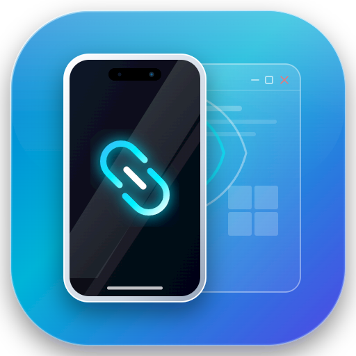

<p align="center">
  
</p>

<h1 align="center">📱🔗 iPhone Link — Native iPhone Mirroring &amp; Control for Windows 11</h1>

<p align="center">
  <b>High-Performance, Zero-Delay iPhone Screen Mirroring, Touch Control &amp; Cross-Platform OCR Suite for Windows.</b><br>
  <i>Inspired by Windows Phone Link &amp; macOS Sequoia iPhone Mirroring.</i>
</p>

<p align="center">
  <a href="https://github.com/kelvindaniyar"></a>
  <a href="https://saweria.co/kelvindaniyar" target="_blank"></a>
  <a href="https://github.com/teyboxv1/pane-iphone-mirror-windows"></a>
  
  
  
  
</p>

> ### 🛡️ Tested & Verified Environment
> - 📱 **Target Device**: **iPhone 17 Pro** (Physical Device running **iOS 27.0.1**)
> - 💻 **PC / Operating System**: **Windows 11 Version 26H2** (Build 26100+, 64-bit)
> - 🚀 **Performance**: 60fps Zero-Delay Hardware HEVC Stream & Full Touch / OCR Control

---

### 🌟 Author, Attribution & Open-Source Lineage
> - **Creator & Lead Developer of iPhone Link**: **Kelvin Daniyar** ([GitHub `@kelvindaniyar`](https://github.com/kelvindaniyar) · [Instagram `@kelvin.daniyar`](https://www.instagram.com/kelvin.daniyar/) · [TikTok `@kelvindaniyar`](https://www.tiktok.com/@kelvindaniyar)).  
>   Designed and engineered **iPhone Link** (WinUI 3 Liquid Glass Frameless UI, Responsive Compact Top Bar, Mac-Style Stealth Dim Mode 0% with ~25% Calibrated Restore, Remote Wake & Auto-PIN Unlock, Landscape Gaming Mode `Alt+H` with Inverse Touch Matrix, Bidirectional Smart OCR Copy-Paste for Apple Notes & Google Keep, Smart Auto-Clear Cache, and Bluetooth Audio Sink).
> - **Upstream Open-Source Source (Forked From)**: Developed from the foundational open-source project [**teyboxv1/pane-iphone-mirror-windows**](https://github.com/teyboxv1/pane-iphone-mirror-windows) by **teyboxv1**, licensed under the **GNU General Public License v3.0 (GPL-3.0)**.  
>   We gratefully acknowledge and credit **teyboxv1** and the open-source contributors of Pane and **[pymobiledevice3](https://github.com/doronz88/pymobiledevice3)** (by Doron Zavelevsky) for establishing the foundational USB RemoteXPC tunneling mechanism that made native iOS mirroring on Windows possible.

---

## 🚀 Key Features Overview

| Feature | Description |
| :--- | :--- |
| **🪟 WinUI 3 Liquid Glass UI** | Frameless, modern Windows 11 Mica/Acrylic aesthetic with smooth rounded corners, edge-to-edge video canvas, and collapsible settings side drawer. |
| **⚡ 60fps Zero-Delay Mirroring** | Ultra-responsive 60fps video stream over USB cable, powered by Edge WebView2 hardware-accelerated HEVC (H.265) decoding and WebCodecs. |
| **🌑 Mac-Style Stealth Dim Mode** | Meremotely dims the physical iPhone OLED display down to **0% brightness (completely dark on your desk)** while mirroring remains 100% bright in Windows. |
| **💡 Calibrated ~25% Brightness Restore** | Restores the physical iPhone display to exactly **4 single iOS bars (~25% brightness)** on exit or stealth toggle, with strict guards preventing 100% brightness surges. |
| **🎮 Landscape Gaming Mode (`Alt+H`)** | Full 90°/270° canvas rotation with dynamic aspect-ratio adaptation (19.5:9 widescreen), inverse touch mapping matrix for landscape games (*eFootball*, *Genshin Impact*, *Call of Duty*), and maximized PC monitor viewing. |
| **🔓 Remote Wake &amp; Auto-PIN Unlock** | Wakes your iPhone screen, executes an automated swipe-up, bypasses the Face ID scanning delay on newer devices (iPhone 16/17 Pro), and injects your PIN via isolated HID keycodes. |
| **🔒 Remote Screen Lock (`Alt+L`)** | Instantly puts your physical iPhone into standby sleep with one keystroke or UI button. |
| **📋 Bidirectional Smart OCR Copy-Paste** | High-precision Windows OCR engine for **Apple Notes** and **Google Keep**: repairs split words (`Cut-Off`), neutralizes selection handles, stitches multi-screen captions, and copies text directly to Windows Clipboard. |
| **⌨️ Direct PC-to-iPhone Paste (`Alt+V`)** | Pastes text from your Windows Clipboard directly into the focused iOS text field via raw HID keystroke simulation. |
| **🧹 Smart Auto-Clear Cache** | Automatically flushes OCR stitching memory whenever you return Home, switch apps, or press Back, preventing cross-app text contamination. |
| **🖱️ 2-Finger Trackpad &amp; Smooth Scroll** | Natural precision scrolling with mouse wheel and Windows laptop trackpads. |
| **🔊 Bluetooth Audio Sink** | Stream iPhone media audio directly into Windows PC speakers or headphones. |

---

## ⌨️ Keyboard Shortcuts Reference

iPhone Link provides intuitive global keyboard shortcuts mapped for maximum productivity:

| Shortcut | Action | Description |
| :---: | :--- | :--- |
| **`Alt + H`** | **🔄 Toggle Landscape Mode** | Switches instantly between Vertical Portrait (0°) and Horizontal Landscape (270° eFootball Gaming Mode). |
| **`Alt + C`** | **📥 Copy iPhone Text** | Runs Smart OCR on the selected iPhone screen region and copies clean text to your Windows Clipboard (`✓ Copied to PC!`). |
| **`Alt + V`** | **📋 Paste PC Text** | Injects text from your Windows Clipboard into the active iPhone app as native keystrokes. |
| **`Alt + R`** | **🧹 Clear Copy Cache** | Flushes OCR session chunk memory manually (`✓ Cache Cleared!`). |
| **`Alt + D`** | **🌑 Toggle Stealth Dim** | Switches physical iPhone display between 0% (Stealth Dim) and calibrated ~25% brightness. |
| **`Alt + U`** | **🔓 Remote Wake &amp; Unlock** | Wakes iPhone, swipes up, bypasses Face ID delay, and inputs PIN. |
| **`Alt + L`** | **🔒 Lock iPhone Screen** | Safely restores brightness if dimmed, then puts iPhone to sleep. |
| **`Ctrl + K`** | **⌨️ Toggle On-Screen Keyboard** | Shows / hides the iOS virtual software keyboard. |
| **`Ctrl + C`** | **Internal iOS Copy (⌘C)** | Instant internal copy within iOS apps without triggering Windows OCR. |
| **`Ctrl + V`** | **Internal iOS Paste (⌘V)** | Instant native iOS paste preserving all internal rich formatting. |
| **`Ctrl + A`** | **Select All (⌘A)** | Selects all text in the focused iOS field. |
| **`Ctrl + Z`** | **Undo (⌘Z)** | Reverses the last text action in iOS. |

---

## 📦 Quick Start Guide

### 📋 Prerequisites & iPhone Setup (Persyaratan Sistem & Konfigurasi iPhone)

#### 1. PC Requirements
- **Operating System**: Windows 10 atau Windows 11 26H2 (64-bit).
- **Apple USB Drivers**: Pasang aplikasi resmi **[Apple Devices](https://apps.microsoft.com/detail/9np83lwlpz9k)** (atau iTunes) dari Microsoft Store agar Windows mengenali driver USB *Apple Mobile Device*.

#### 2. iPhone Configuration (Wajib Mengaktifkan Developer Mode)
Sebelum menjalankan iPhone Link, pengguna **WAJIB** mengaktifkan **Developer Mode (Mode Pengembang)** pada iPhone:
- Hubungkan iPhone ke PC menggunakan kabel data USB.
- Pada layar iPhone, ketuk **Percayai Komputer Ini (Trust This Computer)** dan masukkan PIN layar kunci Anda.
- Buka **Pengaturan (Settings) → Privasi & Keamanan (Privacy & Security) → Mode Pengembang (Developer Mode)**.
- Geser toggle ke posisi **Nyalakan (ON)**. iPhone akan meminta konfirmasi untuk memulai ulang (restart).
- Setelah iPhone menyala kembali, buka kunci layar iPhone dan ketuk **Nyalakan (Turn On)** pada pop-up konfirmasi, lalu masukkan PIN Anda sekali lagi.

---

> ### 💡 Tips Khusus: Cara Memunculkan Menu Developer Mode yang Tersembunyi via 3uTools
> *(How to Reveal Hidden Developer Mode Menu on iPhone via 3uTools)*
>
> **Kendala / Problem**:  
> Pada iPhone baru atau iPhone yang belum pernah disambungkan ke Mac / Xcode, Apple secara default **menyembunyikan menu "Mode Pengembang (Developer Mode)"** di dalam *Pengaturan → Privasi & Keamanan*.
>
> **Solusi Cepat 1-Menit (Bahasa Indonesia)**:
> 1. Unduh dan pasang aplikasi gratis **[3uTools](https://www.3u.com/)** di PC Windows Anda.
> 2. Hubungkan iPhone ke PC via kabel USB dan ketuk *Trust This Computer* (Percayai Komputer Ini).
> 3. Buka 3uTools, lalu masuk ke tab menu **Toolbox → Realtime Screen**.
> 4. Begitu jendela *Realtime Screen* terbuka, layanan Apple Developer Service secara otomatis diinisialisasi pada iPhone Anda, dan menu **Mode Pengembang (Developer Mode)** akan **seketika muncul secara ajaib** di iPhone pada:  
>    **Pengaturan → Privasi & Keamanan → Mode Pengembang** (di bagian paling bawah).
> 5. Buka menu tersebut di iPhone, geser ke posisi **Nyalakan (ON)**, lalu restart iPhone Anda. Setelah restart, tekan *Turn On* dan masukkan PIN layar kunci. Anda sekarang 100% siap menggunakan iPhone Link!
>
> ---
>
> **English Quick Guide**:
> *By default, iOS hides the Developer Mode toggle under Settings → Privacy & Security on devices that have never been connected to Xcode or a developer environment.*  
> 1. Download and install **[3uTools](https://www.3u.com/)** on your Windows PC.  
> 2. Connect your iPhone via USB cable and tap *Trust This Computer*.  
> 3. In 3uTools, navigate to **Toolbox → Realtime Screen**.  
> 4. As soon as *Realtime Screen* launches, it mounts the developer disk image, and the hidden **Developer Mode** toggle will **instantly appear** at the bottom of:  
>    **Settings → Privacy & Security → Developer Mode**.  
> 5. Toggle it **ON**, allow your iPhone to reboot, and tap *Turn On* upon restart. iPhone Link is now 100% ready to mirror!

---

### Option 1: Portable Release (Recommended — No Setup Required)
1. Download the latest **`iPhone-Link-Portable-v1.0.0.zip`** from [**Releases**](../../releases/latest).
2. Extract the ZIP archive anywhere on your PC.
3. *(Optional 1-Click)* Double-click **`Create-Desktop-Shortcut.bat`** to generate a desktop and Start Menu shortcut with the official app icon!
4. Double-click **`iPhone Link.bat`** to start the app.
5. Click **Start mirroring** and enjoy 60fps low-latency control!

---

### 🔒 Privacy & Clean Uninstall

Privasi dan kendali data Anda adalah prioritas mutlak iPhone Link:
- **Hapus Bersih dari UI**: Di dalam menu Pengaturan (Side Drawer) bagian *iPhone Screen & Stealth Control*, klik tombol **`🗑️ Clear Saved PIN & Privacy Data`** untuk menghapus instan PIN dari memori browser, riwayat viewport, dan file log lokal.
- **1-Klik Clean Uninstaller (`Uninstall-iPhone-Link.bat`)**: Ingin menghapus total iPhone Link dari PC Anda? Cukup klik 2x script **`Uninstall-iPhone-Link.bat`** di dalam folder rilis. Script ini otomatis:
  1. Menghentikan semua proses latar belakang iPhone Link.
  2. Menghapus tuntas seluruh cache WebView2 / `pywebview` (termasuk PIN `localStorage`).
  3. Menghapus riwayat ketik lokal, pengaturan, dan cache OCR.
  4. Menghapus shortcut Desktop dan Start Menu Windows.
  5. Memberikan opsi konfirmasi untuk menghapus seluruh folder aplikasi dari harddisk.

---

### Option 2: Run from Source

```powershell
# 1. Clone repository
git clone https://github.com/kelvindaniyar/iphone-link.git
cd iphone-link

# 2. Set up Python virtual environment
python -m venv venv
.\venv\Scripts\activate

# 3. Install dependencies
pip install -r requirements.txt

# 4. Launch iPhone Link
.\iPhone Link.bat
# (or run via: python handset/gui.py)
```

---

## 🛠️ Architecture & Under the Hood

iPhone Link establishes a secure, local-only communication pipeline between your Windows PC and iPhone:

```
┌─────────────────┐       USB Cable (RemoteXPC / RSD Tunnel)       ┌────────────────────────┐
│  iPhone Device  │ ◄─────────────────────────────────────────────► │ iPhone Link Server     │
│  (iOS 17 - 27+) │   • 60fps HEVC Video Stream (Port 62078)        │ (127.0.0.1:8765)       │
└─────────────────┘   • Direct HID Multi-Touch & Keystrokes         └───────────┬────────────┘
                      • Consumer Page Display Brightness / Power                │
                                                                                │ Local WebSockets / HTTP
                                                                                ▼
                                                                    ┌────────────────────────┐
                                                                    │ WinUI 3 Frameless GUI  │
                                                                    │ (WebView2 / WebCodecs) │
                                                                    └────────────────────────┘
```

1. **RSD / RemoteXPC Tunneling**: Uses `pymobiledevice3` to securely establish a CoreDevice tunnel over USB.
2. **Hardware HEVC Decoding**: Streams raw H.265 NAL units directly to Edge WebView2's WebCodecs video decoder, eliminating frame lag.
3. **Isolated Direct HID Injection**: Passes mouse clicks as capacitive touch points (`0..32768`) and keyboard strokes through USB HID Consumer and Keyboard usage pages.
4. **Local Privacy**: 100% of video streaming, OCR computation, and keyboard inputs stay on your local machine (`127.0.0.1`). No cloud telemetry or third-party servers are ever contacted.

---

## 💖 Support This Project (Donasi & Dukungan)

Jika **iPhone Link** membantu produktivitas harian, pekerjaan kreatif, atau pengalaman gaming Anda di Windows 11, Anda dapat mendukung pengembangan proyek open-source ini melalui **Saweria**:

<p align="left">
  <a href="https://saweria.co/kelvindaniyar" target="_blank">
    
  </a>
</p>

* 🔗 **Saweria Link:** [**https://saweria.co/kelvindaniyar**](https://saweria.co/kelvindaniyar)

---

## 📄 License & Credits

- **Creator & Lead Developer**: [**Kelvin Daniyar**](https://github.com/kelvindaniyar) ([@kelvindaniyar](https://github.com/kelvindaniyar)).
- **License**: GNU General Public License v3.0 ([GPL-3.0](LICENSE)).
- **Upstream Project**: Forked and enhanced from [**teyboxv1/pane-iphone-mirror-windows**](https://github.com/teyboxv1/pane-iphone-mirror-windows) by teyboxv1.
- **Core Library**: Powered by [pymobiledevice3](https://github.com/doronz88/pymobiledevice3) by Doron Zavelevsky.
